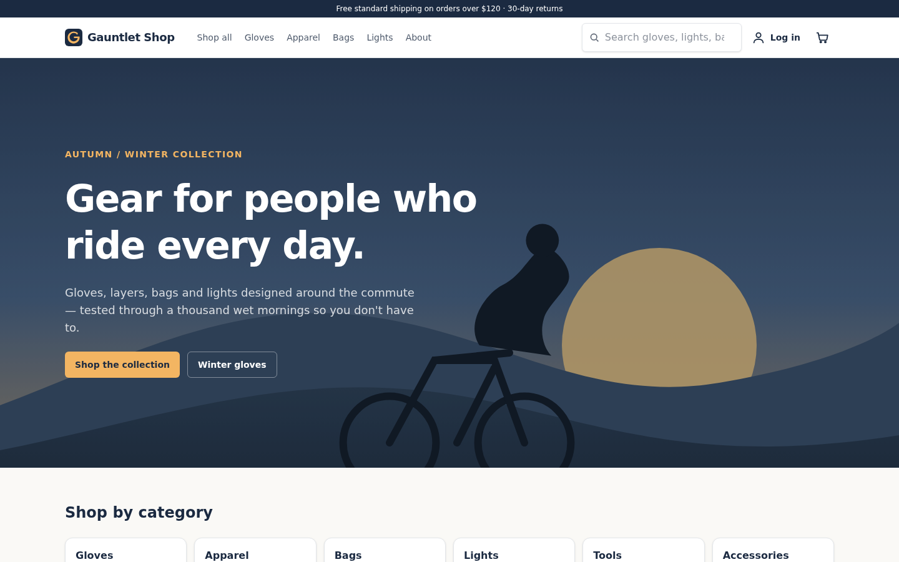
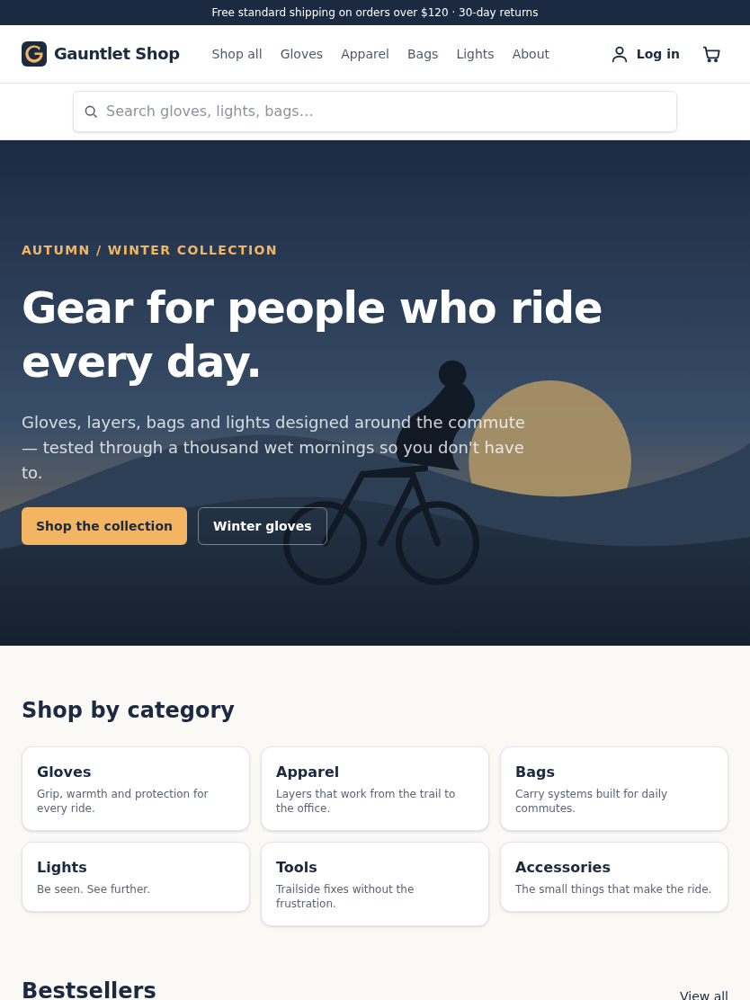
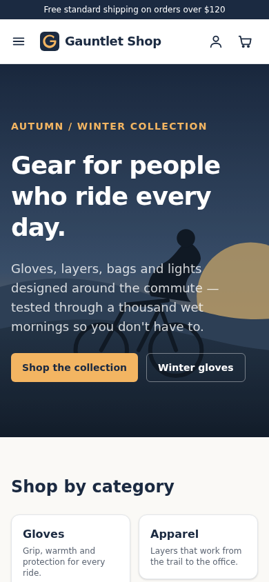
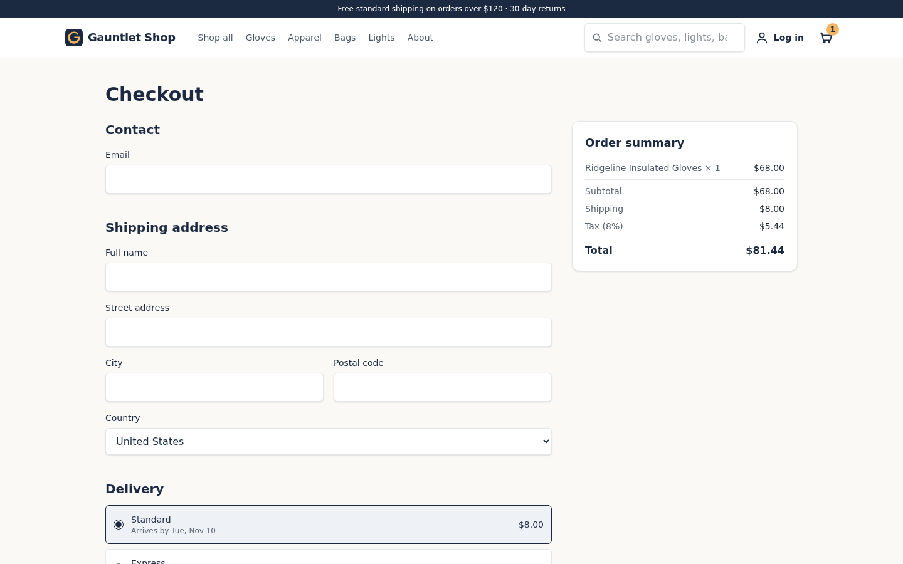
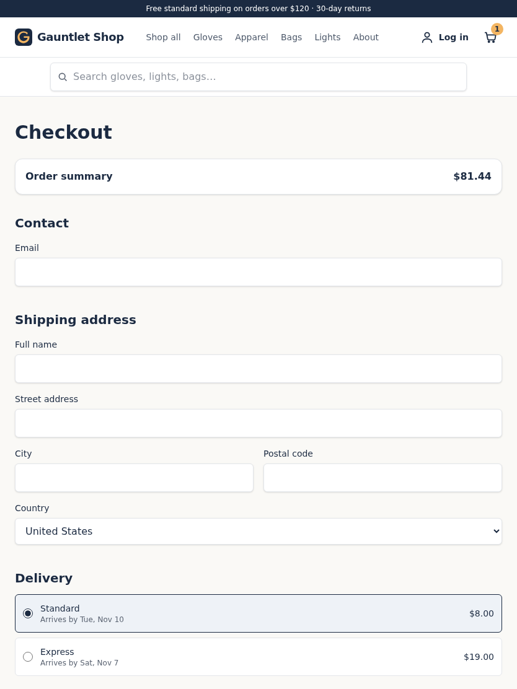
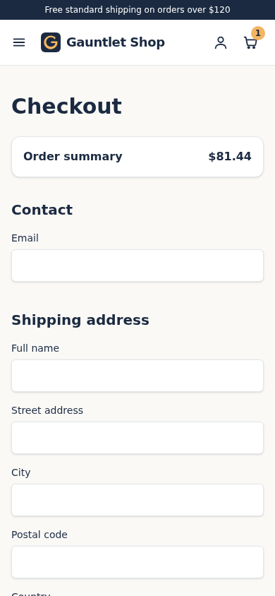

# Regression Gauntlet

A benchmark and demo asset for AI end-to-end testing tools.

It is a small but realistic storefront (**Gauntlet Shop**, Next.js App Router + TypeScript + Tailwind) with a clean, passing Playwright + axe-core baseline, plus **25 open pull requests that each introduce exactly one realistic, user-visible regression** and **5 control PRs** that change nothing a user should notice. Ground truth lives only on `main` (`gauntlet/manifest.json`, `gauntlet/ANSWER-KEY.md`); PR descriptions read like ordinary dev PRs. A scorer turns a tester's per-PR report into precision / recall / F1 overall, per bug class, per device and per expected-detection tier.

| Desktop 1440 | Tablet 834 | Mobile 390 |
| --- | --- | --- |
|  |  |  |
|  |  |  |

## Why

A new category of testing tools maps an app's user flows and, on every pull request, runs simulated users through those flows on the PR's preview build and on production, per device / browser / network, then reports which flow broke where. Simulithic describes this model in its [pull-request checks docs](https://www.simulithic.com/docs/pull-request-checks) and the reasoning behind it in [“Verification engineering”](https://www.simulithic.com/verification-engineering); other tools work similarly.

Evaluating such a tool is hard without ground truth: you need an app whose baseline is known-good, a set of changes whose effect is known exactly, and controls to measure false positives. Regression Gauntlet provides that so a team can

- measure recall and precision of a PR check **per bug class and per device**,
- demo “open a PR, watch the regression get caught” on something that looks like a real product, and
- catch regressions in the tester itself (run it against the same 30 PRs after every change).

## What is in the repo

```
app/, components/, lib/     Gauntlet Shop (Next.js 15, no database, no env vars, no external services)
tests/                      Baseline Playwright suite (+ axe-core) — must pass on main at 1440 / 834 / 390
gauntlet/manifest.json      Ground truth for every bug and control PR (only on main)
gauntlet/ANSWER-KEY.md      Human-readable version of the manifest
gauntlet/proofs/            One targeted Playwright proof per bug: passes on main, fails on the bug branch
gauntlet/verify.sh          Builds every bug branch and proves the regression is real (results below)
gauntlet/score.py           Scores a tester report against the manifest
gauntlet/report.schema.json JSON schema of the report; gauntlet/sample-report.json is an illustrative example
gauntlet/seed/              The scripts that generated the branches/PRs/manifest (reproducible)
docs/ci/github-actions.yml  Optional GitHub Actions workflow (lint/type/build per PR, e2e on main); not enabled by default, see Limitations
docs/screenshots/           Screenshots at the three widths
```

### The app

Six flows, all local and deterministic:

| Flow | What it does | State |
| --- | --- | --- |
| browse → product → cart → checkout → confirmation | 18 products in 6 categories, cart drawer, promo codes (`GAUNTLET10`, `FREESHIP`), fake card form (`4242…` succeeds, `4000 0000 0000 0002` is declined), order confirmation | cart in `localStorage`, orders in a cookie |
| sign up / log in | demo account `demo@gauntlet.shop` / `password123`, or sign up with any email | cookie session |
| search + filter | header typeahead (`/api/products`), catalog filters (category, price cap, in-stock, sort) | URL params |
| account settings | display name, default city/country, marketing opt-in; must survive a reload and prefill checkout | cookie-backed profile |
| newsletter | footer form with success/error states, remembered on reload | cookie |
| mobile nav | hamburger menu < 768 px, keyboard accessible, body scroll lock | — |

Everything is synthetic: product copy and SVG artwork are generated, “payments” never leave the browser, and all persistence is per-browser (cookies / localStorage). There is no account database, so two browsers never share state.

## Quick start

```bash
npm install
npm run dev                       # http://localhost:3000

npx playwright install --with-deps chromium firefox webkit
npx playwright test               # baseline suite: 5 projects (Chromium 1440/834/390, Firefox 1440, WebKit 1440)
```

`npm run build && npm start` serves the production build. The app deploys to Vercel with zero configuration.

## The seeded PRs

Every bug lives on its own branch `bug/NN-short-slug` cut from the same base commit (`manifest.base_commit`) and is open as a PR against `main`; controls are `control/NN-…`. Each diff is small and plausible — the kind of change a developer or coding agent ships with a reasonable-sounding description. **Do not read the PR descriptions as hints: they are written to not reveal the bug.**

Open PRs: https://github.com/sharonbasovich/regression-gauntlet/pulls

### Bug-class taxonomy

| Class | Count | Idea | Example from the manifest |
| --- | --- | --- | --- |
| functional | 5 | core behaviour wrong | coupon shows a discount line but the total does not change; price sort reversed |
| mobile-only | 3 | only below 768 px / on phones | invisible menu panel swallows every tap; sticky CTA calls `form.submit()` and places nothing |
| browser-specific | 2 | one engine only | WebKit: cart never hydrates (`requestIdleCallback?.()`); Firefox: promo code does nothing (`scrollIntoViewIfNeeded`) |
| network-perf | 3 | latency / payload pressure | 3 s client timeout on checkout; 3.9 MB hero PNG; typeahead race without request ordering |
| state-persistence | 3 | write “succeeds”, state lost | settings cookie scoped to `/api/account`; guest cart wiped on login |
| a11y-usability | 4 | keyboard / SR / contrast | focus trap removed; cart button loses its name; muted text at ~2.5:1; Escape no longer closes the drawer |
| visual-layout | 2 | overflow / clipping | header wider than a 390 px viewport; compare-at price clipped on cards |
| silent-failure | 3 | UI says OK, nothing happened | guest newsletter “Thanks!” stores nothing; typeahead 500 swallowed into `[]`; order placed but confirmation says “not found” |
| **controls** | 5 | no user-visible regression | pure refactors, a copy tweak, and one deliberate harmless visual change (card radius) |

Each manifest entry records: `class`, `severity`, affected `flows`, `devices`, `browsers`, `network` condition, `expected_detection`, a one-line `repro`, the `files` the PR touches, and the proof spec/project. `expected_detection` is the author's judgement of what it takes to catch the bug:

- **scripted** — a deterministic happy-path spec of the affected flow fails on the branch (10 bugs)
- **journey** — needs a specific multi-step or state-asserting journey: reload, second click, two variants, redirect (8 bugs)
- **judgement** — needs a non-default condition (throttled network, real device, a specific engine) or visual/UX/a11y judgement (7 bugs)

## Pointing an AI tester at it

Live production build of `main`: **https://regression-gauntlet.vercel.app** (Vercel, Deployment Protection off). Every PR branch gets a public Vercel preview URL (`regression-gauntlet-git-<branch-slug>-sharon-basovichs-projects.vercel.app`, also linked from the PR's Vercel bot comment), so a PR-vs-production tester can be pointed at this repo as-is.

Most PR-check tools want a production URL to map and a preview URL per PR to compare against. With Vercel:

1. Fork or import the repo in Vercel (framework preset: Next.js; no environment variables needed). `main` becomes production.
2. **Disable Deployment Protection** for the project (Project → Settings → Deployment Protection → Vercel Authentication → *Disabled*). Preview URLs behind Vercel SSO are not reachable by an external tester.
3. With the GitHub integration enabled, every open `bug/*` and `control/*` PR gets its own preview deployment and a `vercel[bot]` comment with the URL. If you prefer the CLI: `npm i -g vercel && vercel link`, then `vercel` on a branch for a preview and `vercel --prod` on `main`.
4. Map/flows from the production URL, then let the tool check each PR's preview against production. Record, per PR, what it reported broken on which flow and device.

For Simulithic specifically this is `simulithic map <production-url>` followed by its PR check on each open PR (see their docs linked above); the same shape works for any tool.

Locally, each branch is just `git checkout bug/NN-… && npm run build && npm start`.

## Reporting and scoring

Write a report that follows `gauntlet/report.schema.json` — one entry per PR, each with the observations the tester made:

```json
{
  "tester": "my-tool 1.2",
  "prs": [
    { "branch": "bug/03-cart-badge-stale",
      "observations": [ { "flow": "cart", "device": "mobile", "verdict": "broken", "note": "badge still shows 1 after removing the item" } ] },
    { "branch": "control/04-card-radius",
      "observations": [ { "flow": "browse", "device": "desktop", "verdict": "ok" } ] }
  ]
}
```

A PR counts as **flagged** if any observation is `broken`. Then:

```bash
python3 gauntlet/score.py my-report.json            # prints the tables below
python3 gauntlet/score.py my-report.json --json out.json
```

The scorer prints a per-PR table (result, flows/devices flagged, whether a flagged flow matches the manifest), then precision / recall / F1 overall (bug PRs vs control PRs), recall per class and per expected-detection tier, and per-device precision / recall (a bug counts for a device if the manifest lists it; a detection counts on a device only if a `broken` observation names that device). PRs missing from the report count as not flagged.

`gauntlet/sample-report.json` is a **hand-written, illustrative** report that exists only to show the format and exercise the scorer; its numbers are not results from any tool.

## Verification

`gauntlet/verify.sh` builds `main`, runs every proof against it (all must pass), then for each bug branch builds it in a git worktree, starts it, and runs that bug's proof (it must fail). With `--baseline` it also runs the full baseline suite against each branch and records how many baseline tests fail — an honest measure of what a plain scripted suite catches.

Latest run (`gauntlet/verify.sh --baseline`, all 25 bug branches, base `ef498d0`): **25/25 verified** — every proof passes on main, every branch builds, and every proof fails on its branch. The last column is how many of the 155 baseline tests fail on that branch. Read it carefully: **18/25 bugs break at least one baseline test that exercises the bug; 7 do not** — BUG-08 (iOS zoom), BUG-16 (typeahead race), BUG-19 (cannot opt out of marketing) and BUG-24 (clipped prices) had zero failures, and the single failure recorded for BUG-13, BUG-14 and BUG-15 was an unrelated flaky test (an axe `document-title` timing check on the account page in Firefox/mobile, and a WebKit coupon test reading totals before hydration), not the seeded bug. Both flaky tests were hardened on main afterwards. Those seven are the bugs that need a judgement call or a non-default journey/condition. Full table also in `gauntlet/VERIFY-RESULTS.md` / `verify-results.json`.

Generated 2026-11-05T09:14:09Z — 25/25 bugs verified (proof passes on main, branch builds, proof fails on branch).

| Bug | Class | Proof project | Proof on main | Branch build | Proof on branch | Baseline suite failures on branch |
|---|---|---|---|---|---|---|
| BUG-01 | functional | desktop-1440 | pass | ok | fails | 6 |
| BUG-02 | functional | desktop-1440 | pass | ok | fails | 5 |
| BUG-03 | functional | desktop-1440 | pass | ok | fails | 13 |
| BUG-04 | functional | desktop-1440 | pass | ok | fails | 5 |
| BUG-05 | state-persistence | desktop-1440 | pass | ok | fails | 6 |
| BUG-06 | mobile-only | mobile-390 | pass | ok | fails | 17 |
| BUG-07 | mobile-only | mobile-390 | pass | ok | fails | 5 |
| BUG-08 | mobile-only | mobile-390 | pass | ok | fails | 0 |
| BUG-09 | visual-layout | mobile-390 | pass | ok | fails | 6 |
| BUG-10 | browser-specific | webkit-1440 | pass | ok | fails | 8 |
| BUG-11 | browser-specific | firefox-1440 | pass | ok | fails | 2 |
| BUG-13 | functional | desktop-1440 | pass | ok | fails | 1 |
| BUG-14 | network-perf | desktop-1440 | pass | ok | fails | 1 |
| BUG-15 | network-perf | desktop-1440 | pass | ok | fails | 1 |
| BUG-16 | network-perf | desktop-1440 | pass | ok | fails | 0 |
| BUG-18 | state-persistence | desktop-1440 | pass | ok | fails | 5 |
| BUG-19 | state-persistence | desktop-1440 | pass | ok | fails | 0 |
| BUG-20 | a11y-usability | desktop-1440 | pass | ok | fails | 5 |
| BUG-21 | a11y-usability | desktop-1440 | pass | ok | fails | 55 |
| BUG-22 | a11y-usability | desktop-1440 | pass | ok | fails | 56 |
| BUG-23 | a11y-usability | desktop-1440 | pass | ok | fails | 10 |
| BUG-24 | visual-layout | desktop-1440 | pass | ok | fails | 0 |
| BUG-26 | silent-failure | desktop-1440 | pass | ok | fails | 5 |
| BUG-27 | silent-failure | desktop-1440 | pass | ok | fails | 8 |
| BUG-28 | silent-failure | desktop-1440 | pass | ok | fails | 10 |

The proof for BUG-15 (LCP) throttles the network through CDP and is Chromium-only; BUG-10 runs on WebKit and BUG-11 on Firefox. All other proofs run on Chromium at the listed width.

## Limitations (please read)

- **Synthetic app, synthetic data.** Payments, accounts and orders are all fake and per-browser. There is no backend state, so bugs that only appear across sessions/users or under real load are out of scope.
- **The bugs are seeded by the author.** Classes, severities and `expected_detection` tiers are judgement calls, not measurements. Treat the tier as a hint, not a label.
- **Each PR has exactly one intended regression**, but a diff can have incidental side effects (e.g. BUG-06 also leaves an `aria-hidden` panel in the DOM). The manifest describes the intended, user-visible effect.
- **Some bugs cannot be fully proven in headless Playwright.** BUG-08 (iOS focus zoom) is proven only by its root cause (input font-size < 16 px); BUG-15 is proven by LCP under CDP throttling rather than on a real 3G connection.
- **Browser-specific bugs rely on current engine behaviour** (`requestIdleCallback` absent in WebKit, `scrollIntoViewIfNeeded` absent in Firefox as of the Playwright builds used). If an engine ships the API, the proof will start passing on the branch — re-run `verify.sh`.
- **No CI runs on this repository by default.** `verify.sh` is the source of truth and its results are committed (`gauntlet/VERIFY-RESULTS.md`). A ready-to-use GitHub Actions workflow lives in `docs/ci/github-actions.yml` (lint/type-check/build on PRs; the e2e baseline only on pushes to `main`, so a red check cannot leak which PRs contain a bug) — copy it to `.github/workflows/` to enable it on a fork.
- **The control set is small (5).** Precision estimates from five negatives are coarse; `control/04` is a deliberate visual change to see whether a tester flags harmless visual diffs.
- **Scoring is PR-level.** The per-device table credits a device only when the tester names it, so a tool that reports without device attribution will score low there by construction.

## Reproducing the branches

```bash
python3 gauntlet/seed/seed.py --manifest                       # rewrite the manifest from the definitions
python3 gauntlet/seed/seed.py --base <sha> --branches --check  # recreate all branches in git worktrees (+ tsc/eslint)
python3 gauntlet/seed/seed.py --branches --push --pr           # push and open PRs with gh
python3 gauntlet/seed/answer_key.py                            # regenerate ANSWER-KEY.md
```

## License

MIT — see `LICENSE`. Gauntlet Shop, its products and its artwork are fictional.
